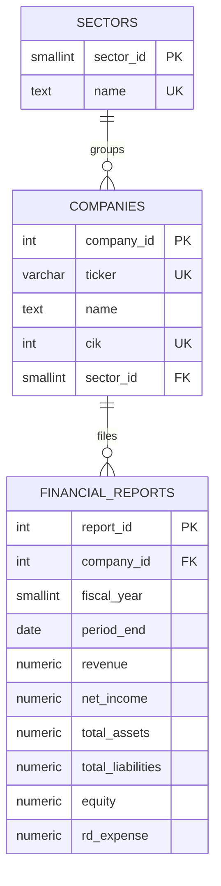

# Healthcare Company Financials in PostgreSQL

A small analytics database built from **real SEC EDGAR filings** (Form 10-K, XBRL API) for 10 US healthcare companies: schema design, an automated Python loader, and SQL analysis with window functions, CTEs and a reporting view.

## Quick start

Requirements: Docker, Python 3.9+.

```bash
# 1. Start PostgreSQL (creates the tables from schema.sql automatically)
docker compose up -d

# 2. Install dependencies and load data from SEC EDGAR
pip install -r requirements.txt
python load_edgar.py --email you@example.com \
  --dsn "host=localhost port=5432 dbname=finance_db user=finance password=finance"

# 3. Run the analysis
docker compose exec db psql -U finance -d finance_db -f /queries.sql
```

SEC requires a contact e-mail in the `User-Agent` header; it is only sent with the API requests and is not stored anywhere.

Without internet access you can try the queries on fictional data (use a fresh database, instead of loading real data):

```bash
# bash
docker compose exec -T db psql -U finance -d finance_db < sample_data_fictional.sql
```

```powershell
# PowerShell
Get-Content sample_data_fictional.sql | docker compose exec -T db psql -U finance -d finance_db
```

## Selected results

Revenue CAGR (2019-2025 unless noted):

| Company | CAGR, % |
|---|---|
| Eli Lilly | 19.6 |
| UnitedHealth | 10.8 |
| AbbVie | 10.7 |
| Bristol-Myers Squibb | 10.7 |
| Merck | 8.8 |
| CVS Health | 7.8 |
| Pfizer | 7.3 |
| Abbott | 5.6 |
| Johnson & Johnson (2021-2025) | 4.6 |
| Medtronic (2019-2026) | 2.5 |

Other observations from the queries:

- In 2025 the highest net margins in pharma were Eli Lilly (31.7%), J&J (28.5%) and Merck (28.1%); AbbVie was lowest (6.9%) against a sector median of 21.4%.
- Pfizer's revenue peaked at USD 101.2 bn in 2022 and fell 41.1% in 2023.
- Average R&D intensity: Merck 29.8%, Eli Lilly 24.5%, Bristol-Myers Squibb 22.0%; device makers 7-8%.
- Eli Lilly's liabilities exceeded 3x equity in every year of the period, AbbVie's in five years (2020-2024).

## About the author

I am a Data Science student looking for a remote junior / internship role in data analysis or data science.

**CV (PDF):** [PASTE_YOUR_CV_LINK_HERE](PASTE_YOUR_CV_LINK_HERE) · **LinkedIn:** [PASTE_YOUR_LINKEDIN_LINK_HERE](PASTE_YOUR_LINKEDIN_LINK_HERE) · **GitHub:** [semiautomatic2](https://github.com/semiautomatic2)

## About the data

**Companies:** Pfizer, Merck, Eli Lilly, AbbVie, Bristol-Myers Squibb, Johnson & Johnson (pharma/biotech), Abbott, Medtronic (medical devices), UnitedHealth Group, CVS Health (services & insurance).

**Period:** fiscal years 2019-2025 (Medtronic through FY2026; J&J from 2021, see [Data notes](#data-notes)). Amounts are in USD millions.

## Data model



The schema is in 3NF. Integrity is enforced in the database: `UNIQUE (company_id, fiscal_year)`, `CHECK` constraints on revenue, assets and liabilities, and a nullable `rd_expense` because not every company reports R&D.

## What is in the repo

| File | Purpose |
|---|---|
| `schema.sql` | tables, constraints, index |
| `load_edgar.py` | downloads 10-K data from the SEC XBRL API and upserts it into PostgreSQL (re-runnable) |
| `queries.sql` | view `v_company_kpi`, 7 analytical queries, 3 data quality checks, `EXPLAIN ANALYZE` |
| `docker-compose.yml` | local PostgreSQL 16 |
| `sample_data_fictional.sql` | fictional data for offline testing only |

## SQL techniques used

- `LAG` for year-over-year growth, `SUM() OVER` for running totals, `RANK() OVER (PARTITION BY ...)` for ranking inside a sector
- CTEs, `PERCENTILE_CONT` (sector median), `POWER` for CAGR
- a reporting view with ROA, ROE, net margin, debt-to-equity and R&D intensity
- data quality checks (balance sheet identity, completeness, missing values) and query plan analysis

## Data notes

- **Fiscal years.** The year is the year in which the fiscal period ends. Medtronic's year ends in April, so it has FY2026. J&J uses a 52/53-week year; period ends in early January are assigned to the previous year.
- **Johnson & Johnson** starts in 2021: earlier revenue includes the consumer business that was later spun off, so it is not comparable. Its R&D values are excluded because the automatically selected XBRL tag was unreliable. Both rules are in `COMPANIES` in `load_edgar.py`.
- **Tags.** Companies change XBRL tags over time, so the loader merges several tags per metric in priority order. If total liabilities are not reported, they are computed as assets minus equity.
- Liabilities-to-equity uses total liabilities, not only debt. No R&D tag was found for UnitedHealth and CVS, so their R&D is left empty.
- The sample is 10 companies and is not representative of the whole sector.

*Educational project. Data comes from public SEC filings; nothing here is investment advice.*
